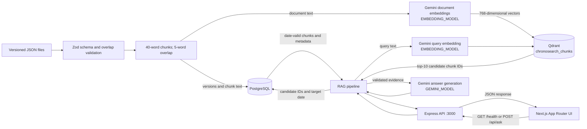

# ChronoSearch — Temporal-Aware RAG System

ChronoSearch is a temporal-aware Retrieval-Augmented Generation (RAG) system for asking questions about versioned documents as of a user-selected date. It retrieves semantically relevant evidence, then checks each candidate against its validity period before generating an answer.

Semantic similarity alone measures topical relevance. It does not determine whether a document version was valid on the requested date, so a standard vector search can surface stale or future policy text. ChronoSearch combines vector search with an authoritative date filter over PostgreSQL records.

## Key features

- Ingests versioned JSON documents with Zod schema validation and checks for overlapping validity periods within a document.
- Splits document content into 40-word chunks with a 5-word overlap and creates 768-dimensional embeddings.
- Searches the Qdrant `chronosearch_chunks` collection for semantically similar chunks (10 candidates by default).
- Applies temporal filtering using `validFrom` and `validUntil` as half-open intervals: `[validFrom, validUntil)`. A null `validUntil` has no scheduled end.
- Generates evidence-grounded answers with requested evidence and source attribution; abstains when no evidence remains valid for the requested date.
- Retries selected transient Gemini HTTP errors up to three times after the initial attempt during answer generation.
- Includes separate retrieval and answer evaluation scripts.

## Architecture and data flow



Ingestion is performed by API scripts, not an HTTP ingestion route. PostgreSQL stores documents, versions, validity dates, and chunk text. Qdrant stores vectors and chunk metadata. At question time, the API embeds the query, retrieves vector candidates from Qdrant, and asks PostgreSQL which candidates were valid on the target date. The validated evidence is sent to Gemini for answer generation. Because temporal filtering follows the top-10 vector search, fewer than 10 chunks (or none) may be returned.

## Technology stack

- **Language and runtime:** TypeScript, Node.js
- **API:** Express 5, `cors`, `dotenv`
- **Web:** Next.js 16 App Router, React 19, Tailwind CSS 4
- **Relational database:** PostgreSQL via `pg`; the SQL migrations are compatible with a Supabase PostgreSQL database
- **Vector store:** Qdrant via `@qdrant/js-client-rest`
- **AI provider:** Google Gemini via `@google/genai`
  - **Embeddings:** `gemini-embedding-001` by default, configurable with `EMBEDDING_MODEL`; document and query embeddings use their respective retrieval task types and 768 dimensions.
  - **Answer generation:** The model is selected by `GEMINI_MODEL`. There is no generation-model default in the code, so configure it separately from the embedding model.
- **Validation:** Zod

## Repository structure

```text
.
├── README.md
└── apps/
    ├── api/
    │   ├── migrations/             # PostgreSQL schema and RLS migrations
    │   ├── sample-docs/            # Policy versions and seven-case evaluation data
    │   └── src/
    │       ├── config/             # PostgreSQL and Qdrant clients
    │       ├── evaluation/         # Retrieval and answer evaluation scripts
    │       ├── generation/         # Evidence-grounded Gemini answer generation
    │       ├── ingestion/          # JSON validation, version checks, chunking, ingestion
    │       ├── repositories/       # PostgreSQL and Qdrant access
    │       ├── retrieval/          # Semantic retrieval and temporal validation
    │       ├── scripts/            # Collection and sample-data utilities
    │       ├── embeddings.ts       # Gemini embedding requests
    │       ├── gemini.ts           # Gemini client
    │       ├── rag.ts              # Retrieval and generation orchestration
    │       └── server.ts           # Express health and question-answering routes
    │   ├── package.json
    │   ├── package-lock.json
    │   └── tsconfig.json
    └── web/
        ├── app/                    # Next.js page, layout, and styles
        ├── package.json
        ├── package-lock.json
        ├── next.config.ts
        ├── eslint.config.mjs
        └── tsconfig.json
```

The API and web app are separate npm projects, each with its own lockfile and install commands. The root directory has no npm package manifest.

## Prerequisites and local setup

- Node.js 20.9 or later, required by the installed Next.js 16 version ([Next.js 16 requirements](https://nextjs.org/docs/app/guides/upgrading/version-16)). The repository does not pin an npm version.
- npm
- A PostgreSQL database, a Qdrant instance, and a Google Gemini API key

Install dependencies in each app directory:

```powershell
cd apps/api
npm ci
```

```powershell
cd apps/web
npm ci
```

Create `apps/api/.env` with the API settings below. Replace placeholders with your own values; do not commit credentials.

```env
DATABASE_URL=your-postgresql-connection-string
QDRANT_URL=your-qdrant-url
QDRANT_API_KEY=your-qdrant-api-key
GEMINI_API_KEY=your-gemini-api-key
GEMINI_MODEL=your-gemini-generation-model
# Optional; defaults to gemini-embedding-001
EMBEDDING_MODEL=gemini-embedding-001
```

`DATABASE_URL`, `QDRANT_URL`, `QDRANT_API_KEY`, and `GEMINI_API_KEY` are read by the API configuration. Answer generation requires `GEMINI_MODEL` when evidence is available. `EMBEDDING_MODEL` is optional. The Qdrant collection must use 768-dimensional cosine vectors.

Apply these SQL files manually to the configured PostgreSQL database, in order:

1. `apps/api/migrations/001_initial_schema.sql`
2. `apps/api/migrations/002_enable_rls.sql`

There is no migration runner. The second migration enables row-level security but does not define policies.

From `apps/api`, create the Qdrant collection and ingest the sample policy versions:

```powershell
npx tsx src/scripts/createCollection.ts
npx tsx src/scripts/reingest.ts
```

The collection script creates `chronosearch_chunks` with 768 dimensions and cosine distance if it does not already exist. Sample ingestion is not a clean upsert: repeating it can encounter existing unique records, and PostgreSQL and Qdrant writes do not share a transaction.

For the web app, create `apps/web/.env.local`:

```env
NEXT_PUBLIC_API_URL=http://localhost:3000
```

`NEXT_PUBLIC_API_URL` is embedded for browser use, so it must contain only the API's browser-reachable URL, never credentials or other secrets.

Run the API from `apps/api`:

```powershell
npm run dev
```

The Express API listens on `http://localhost:3000`. In a second terminal, run the web app from `apps/web`:

```powershell
npm run dev -- --port 3001
```

Open `http://localhost:3001`. API CORS is configured for exactly `http://localhost:3001`; changing the web origin requires changing the CORS origin in `apps/api/src/server.ts`. The API port and CORS origin are hard-coded. No deployment configuration is included.

## API reference

### `GET /health`

Returns HTTP 200 when the Express process is running. This handler does not check PostgreSQL, Qdrant, or Gemini availability.

```json
{
  "status": "OK",
  "project": "ChronoSearch"
}
```

### `POST /api/ask`

Accepts a JSON body with a non-empty `question` string and a valid calendar `targetDate` in `YYYY-MM-DD` format.

```json
{
  "question": "What was the annual equipment allowance?",
  "targetDate": "2025-06-01"
}
```

A successful HTTP 200 response has the `RagResponse` shape:

```json
{
  "question": "What was the annual equipment allowance?",
  "targetDate": "2025-06-01",
  "answer": "<generated answer with evidence and source attribution>",
  "retrievedChunks": 1
}
```

The answer generator is prompted to return an answer, evidence, source, and limitations. If no temporally valid chunks are found, it returns an abstention message and `retrievedChunks` is `0`.

Validation and processing errors use a JSON `error` field:

- HTTP 400 when `question` is missing, not a string, or blank: `{"error":"Question must be a non empty string."}`
- HTTP 400 when `targetDate` is missing or not a real `YYYY-MM-DD` date: `{"error":"Target date must be a valid calendar date in YYYY-MM-DD format."}`
- HTTP 500 when question processing fails: `{"error":"Failed to process the question. Please try again."}`

## Temporal behavior example

The sample `Remote Work Policy` has two adjacent versions:

| Version | Validity interval | Annual equipment allowance |
| --- | --- | --- |
| `v1` | `[2024-01-01, 2026-01-01)` | $300 |
| `v2` | `[2026-01-01, ∞)` | $600 |

- On **2025-06-01**, `v1` is valid and the allowance is **$300**.
- On **2026-01-01**, `v1` has expired and `v2` is valid; the allowance is **$600**.

The boundary date belongs to `v2`: `validUntil` is exclusive, while `validFrom` is inclusive.

## Evaluation

Run both evaluation scripts from `apps/api` after the sample data is ingested and the database, Qdrant, and Gemini settings are available:

```powershell
npm run evaluate
```

The script runs retrieval evaluation followed by answer evaluation against `sample-docs/evaluation-dataset.json`. Retrieval checks that returned chunks belong to the expected version, or that no chunks are returned when no version should be valid. Answer evaluation checks for the expected key phrase, or performs a small abstention check for cases with no evidence; it does not verify every generated claim.

Latest verified results on the current seven-case sample dataset:

- **Retrieval:** 7/7 cases passed (100%).
- **Answers:** 7/7 cases passed (100%).

These results describe this sample dataset only and do not establish universal accuracy. Gemini availability can be intermittent. Answer generation retries selected HTTP statuses (408, 429, 500, 502, 503, and 504) up to three times after the initial attempt. Results are not guaranteed to reproduce across model versions or provider conditions.

## Limitations and future improvements

Current limitations include the top-10 candidate search before temporal filtering, a seven-case evaluation dataset, manual database migrations, and separate PostgreSQL/Qdrant writes that are not atomic. The sample ingestion script is not designed as a repeatable upsert.

Authentication, deployment configuration, production monitoring, and evaluation over a broader document set are possible future improvements; they are not implemented in this repository.

## License

There is no repository-level `LICENSE` file. `apps/api/package.json` declares `ISC` package metadata; this README does not assert a repository-wide license.
